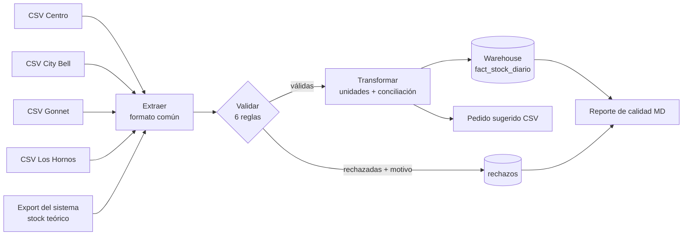

# Pipeline ETL de control de stock multi-sucursal


> 🇬🇧 **English summary:** Daily ETL pipeline that consolidates stock counts sent by 4 branches, each in a different file format (separators, encodings, units, date formats). It validates data quality with explicit rejection reasons, reconciles physical vs. system stock to detect inventory shrinkage, loads an idempotent SQLite warehouse and produces reorder suggestions. Orchestrated with an Apache Airflow DAG and covered by unit and integration tests.

## El problema real

Cada noche, 4 sucursales mandan su conteo de stock. **Cada una lo exporta distinto** y con errores de carga manual. Consolidarlo a mano en Excel llevaba tiempo, los errores pasaban sin detectarse y las diferencias entre el stock físico y el del sistema (robos, mermas no registradas, errores de carga) se descubrían tarde.

| Sucursal | Formato que envía |
|---|---|
| Centro | separador `;`, decimales con coma, fecha `dd/mm/aaaa` |
| City Bell | columnas en inglés (`SKU`, `Qty`), fecha ISO |
| Gonnet | cantidades **en gramos** para productos que se gestionan en kg |
| Los Hornos | codificación `latin-1` y una fila de título antes del encabezado |

Además: códigos mal tipeados (` har-001 `), filas duplicadas, cantidades negativas o vacías, productos inexistentes, fechas imposibles y sucursales que a veces no envían el archivo.

## Arquitectura



Orquestado con Airflow ([`dags/etl_stock_dag.py`](dags/etl_stock_dag.py)), con una tarea por paso, reintentos y una alerta si los rechazos superan el 30% (síntoma de que cambió un formato de exportación):

`verificar_archivos >> extraer >> validar >> transformar_y_cargar >> generar_reportes`

## Decisiones de diseño

- **Nada se descarta en silencio.** Cada fila rechazada queda registrada con archivo, número de fila y motivo, para que la sucursal corrija en origen.
- **Idempotencia.** Reprocesar un día reemplaza ese día en el warehouse dentro de una sola transacción: no duplica ni deja cargas a medias. Está cubierto por un test.
- **Configuración, no código.** Sumar una sucursal con otro formato es agregar una entrada en [`etl/config.py`](etl/config.py).
- **Falla ruidosa ante lo desconocido.** Una unidad sin regla de conversión detiene el proceso en lugar de cargar datos incorrectos.
- **Tolerancia a faltantes.** Si una sucursal no envía su archivo, el resto se procesa igual y el faltante queda en el reporte y en `log_ejecuciones`.

## Resultados sobre una semana de datos de ejemplo

**Calidad:** 347 filas recibidas → **303 cargadas** y **44 rechazadas** (13%), por duplicados (15), cantidades vacías (11), cantidades negativas (10), productos inexistentes (7) y fechas inválidas (1).

**Diferencias de inventario (físico vs sistema):**

| Sucursal | Diferencia promedio | Alertas de diferencia > 5% |
|---|---:|---:|
| **Los Hornos** | **−6,0%** | **41 de 67 conteos** |
| City Bell | −2,7% | 6 de 77 |
| Gonnet | −2,7% | 3 de 82 |
| Centro | −2,6% | 3 de 77 |

👉 **Los Hornos pierde más del doble que el resto de las sucursales.** Sin el pipeline, ese patrón se diluía en el promedio general. Es la señal para auditar recepción de mercadería y registro de mermas en esa sucursal.

```sql
SELECT s.nombre, ROUND(AVG(diferencia_pct), 1) AS dif_prom_pct, SUM(alerta_diferencia) AS alertas
FROM fact_stock_diario f
JOIN dim_sucursal s USING (sucursal_id)
GROUP BY s.nombre
ORDER BY dif_prom_pct;
```

Ejemplo de salida diaria: [`reportes/calidad_20250313.md`](reportes/calidad_20250313.md) y [`reportes/pedido_sugerido_20250313.csv`](reportes/pedido_sugerido_20250313.csv).

## Estructura

```
├── etl/
│   ├── config.py        # rutas, formatos por sucursal, umbrales
│   ├── extraer.py       # lectura y estandarización de columnas
│   ├── validar.py       # reglas de calidad con motivo de rechazo
│   ├── transformar.py   # conversión de unidades, conciliación, reposición
│   ├── cargar.py        # warehouse SQLite idempotente
│   ├── reporte.py       # reporte de calidad y pedido sugerido
│   └── pipeline.py      # orquestación y CLI
├── dags/etl_stock_dag.py
├── tests/test_etl.py    # 15 tests: reglas, transformaciones, idempotencia
├── scripts/generar_archivos_ejemplo.py
├── data/
│   ├── entrada/         # archivos tal como llegan
│   ├── referencia/      # catálogo y sucursales
│   ├── rechazados/      # filas rechazadas por día
│   └── warehouse/       # stock.db
└── reportes/
```

## Cómo ejecutarlo

```bash
git clone https://github.com/Lu1sPerez/etl-control-stock.git
cd etl-control-stock
pip install -r requirements.txt

python scripts/generar_archivos_ejemplo.py   # crea una semana de archivos "sucios"
python -m etl.pipeline --todas                # procesa todas las fechas
python -m etl.pipeline --fecha 2025-03-13     # o un día puntual
pytest -v                                     # corre los tests
```

Con Airflow:

```bash
pip install "apache-airflow==2.10.*"
export AIRFLOW__CORE__DAGS_FOLDER=$(pwd)/dags
airflow dags test etl_control_stock 2025-03-13
```

## Contexto

Este proyecto reproduce, con datos sintéticos, el tipo de proceso que automaticé como Supervisor de Operaciones en una cadena gastronómica de 4 sucursales y un centro de producción, donde desarrollé scripts para el ETL del control de stock que aseguraban la calidad y consistencia de los datos usados para el análisis.

---
**Autor:** Luis Pérez · [LinkedIn](https://www.linkedin.com/in/perezluis24/) · Analista de Datos | BI | Automatización
